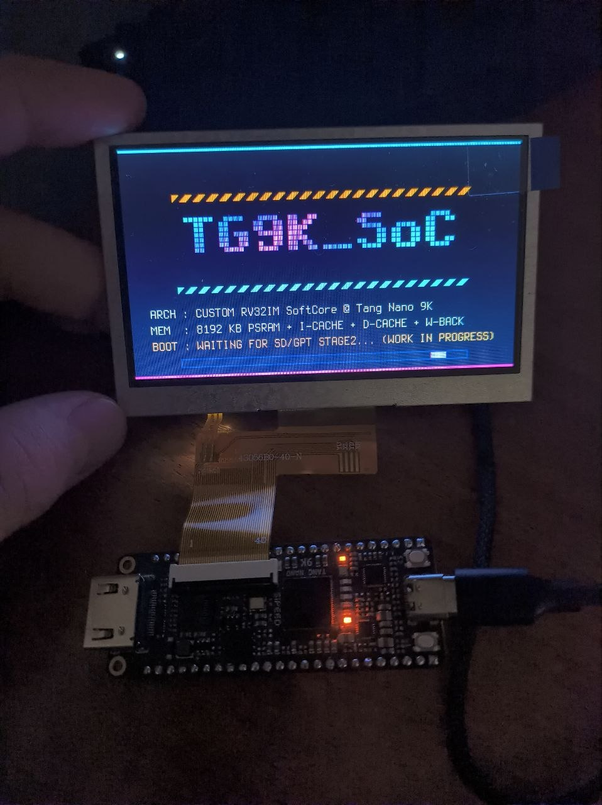

# tangnano9k_soc

~~AI-Free~~ Mostly AI-Free rv32im SoC implementation on Tang Nano 9K, with PSRAM, Cache and display

Goal is to run Linux on it ~~and write all code without using any LLM generated code~~.

**Update**: I have finally caved and abandoned my strict "no-LLM" vow. Blinded by ambition, I tried to build way too much in far too little time, and reality eventually caught up with me. In a moment of weakness, I let AI generate about half of the assembly test programs (in the `asm/` dir) just to keep the momentum going. Yet, the hardware layer still holds the line: the entire Verilog codebase remains strictly handcrafted by me, tarnished only by `lcd.v` and `div.v`. I intend to purge both of them and rewrite lcd.v with my own hands soon, probably followed by div.v too.

Roadmap
- [x] PSRAM wrapper
- [x] Memory Arbiter
- [x] L1 Cache
- [x] RV32I
- [ ] UART & some timers
- [x] LCD/Framebuffer
- [ ] SD Card support
- [ ] RV32IMAC *in progress - RV32IM done*
- [ ] Add Zicsr & Zifencei support to RV32IMAC Core
- [ ] Privileged Modes
- [ ] Boot Linux on it (Buildroot + BusyBox + DTB)
- [ ] Framebuffer driver
- [ ] Run Doom (fbdoom)
- [ ] Independent Linux machine: Edit C code in vi, compile, and run
- [ ] Run Xorg (Nano-X)

